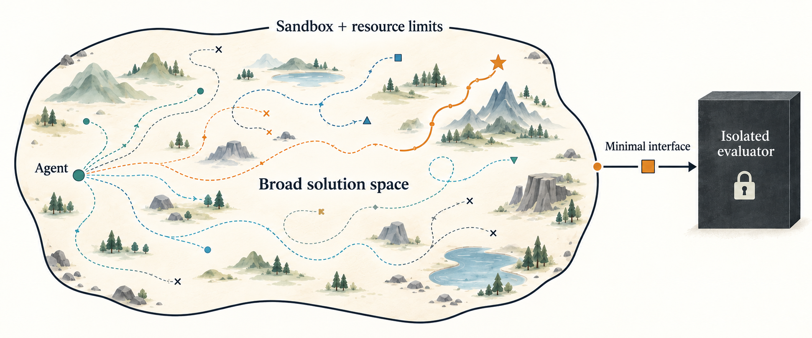

# AutoTrain-Bench

**Constrain resources, not ideas. Define the evaluator, not the solution.**



**A benchmark should define what success means, not tell an AI how to achieve it.**
AutoTrain-Bench is built around this principle: leave the largest practical
solution space open to the Agent within a defined sandbox and resource budget.

> **Preview:** a runnable LM pretraining challenge, a development smoke task,
> and completed experimental runs.
> No frozen, leaderboard-eligible challenge has been released yet.

[Overview](#overview) · [Results](#results) · [Getting Started](#getting-started) ·
[Contributing](#contributing) · [Documentation](#documentation)

## Overview

We should minimize assumptions about what the Agent is supposed to do. The
benchmark should provide only what is necessary:

| Component | What it defines |
| --- | --- |
| **Evaluator** | The objective and what counts as success |
| **Sandbox** | The world the Agent can act within |
| **Resource limits** | Time, compute, storage, network, and other scarce resources |
| **Minimal interface** | The form of the final artifact and how it is evaluated |

Everything else should remain open: whether to train a model at all, which
models and algorithms to use, what data to use or acquire, whether to reuse
existing systems, and how to build infrastructure, organize research, or improve
the Agent itself. These choices belong to the Agent within the sandbox and
resource constraints. Our job is not to manually shrink the solution space
toward approaches we expect.

**Broad freedom requires a strong boundary.** A narrow artifact interface and
strong evaluator isolation let the Agent explore without access to the hidden
evaluator's data or results during research. The sandbox must enforce the resource
budget. Inside those boundaries, the Agent should be left alone. Strategies
unlike anything the designers imagined are a feature of the benchmark.

**Current preview: LM pretraining.** The first implementation is
[LM pretrain](challenges/lm-pretrain/README.md), with a smaller
[development smoke task](dev_tasks/smoke_lm-pretrain/README.md). It still has
task-specific restrictions: fixed task data and artifact requirements, plus
[release policy](challenges/lm-pretrain/POLICY.md) limits on extra training
corpora and pretrained target-model checkpoints. Within those bounds, the Agent
can explore models, optimization, data curation, systems, and research methods;
there is no reference `train.py` to tune.

**Long-term goal: Open World Challenge (not yet developed).** This is the intended
destination for the design philosophy: remove the current challenge's
training-specific assumptions and open the solution space as broadly as
practical, while retaining a defined evaluator, sandbox, resource budget, and
minimal artifact interface.

**The initial system is fixed. Autonomous improvement is allowed.** After task
reveal, the Agent can improve its own software, tools, and research workflow
within the benchmark boundary. External human intervention is excluded.

For the current training tasks, a **Training Lease** gives the Agent bounded
access to the training environment. Two tracks ask complementary questions:

| Track | Budget | Research question |
| --- | --- | --- |
| **A: time-bounded research** | Total elapsed research time, including reasoning, coding, and training | How much can the Agent achieve within a fixed amount of time? |
| **B: lease-bounded research** | Number and maximum duration of Training Leases | How effectively can the Agent use a limited number of training opportunities? |

The Agent receives TRAIN and no organizer-owned validation scores during
research. It commits immutable Candidates and explicitly declares its final
incumbent before research is sealed. Once Agent and Research workloads and
control capabilities are confirmed terminated, hidden TEST evaluates only that
incumbent; postmortem ANALYSIS evaluates the committed history.

Results keep two axes separate: **higher TEST performance** and **lower serving
time per task**. Comparisons use the same release and comparison conditions.

Core defines the benchmark rules. Workers implement execution and isolation in
the user's environment. The repository includes a local Docker runtime;
cluster and other platform integrations live in external Workers.

Official benchmark comparisons will use a small set of published reference
environments. You can adapt runtime profiles for your own hardware and are
responsible for fair conditions across the Agents you compare. Custom runs do
not automatically enter official rankings; see the
[reference environment and comparison policy](challenges/README.md#reference-environments-and-custom-comparisons).

> **Related future work:** We also plan to build on this sandbox in separate
> repositories to explore how Agents can develop and improve their research
> methods, tools, and workflows. This repository will remain focused on the
> benchmark.

## Results

More results will be added after further testing. A dedicated website is planned
to present results in greater detail.

The `lm-pretrain` preview has completed full-data runs in both tracks, using
a public TRAIN pool of approximately **9.95 billion tokens**. Both runs completed
autonomous training, Candidate submission, research sealing, TEST, and postmortem
ANALYSIS.

These September 2026 runs used Codex CLI with `gpt-5.6-sol` at high reasoning
effort, on Core revision [`84f6a72`](https://github.com/liangyuwang/AutoTrain-Bench/commit/84f6a725c59f2c596acf8798e0df6aa4f62948eb).

| Track | Research budget | Training hardware | TEST score ↑ | TEST time per task ↓ |
| --- | --- | --- | --- | --- |
| A | 8 hours | 4 × H100 80 GB | 70.09 | 7.81 ms |
| B | 6 Leases × up to 1 hour | 1 × A100 80 GB, derived preview profile | 65.63 | 3.79 ms |

Scores use the preview's 0–100 performance metric; time per task measures
Candidate serving, not training. These are non-compliant, leaderboard-ineligible
`host_cli` previews with different hardware profiles and Agent CLI versions,
so they are not a controlled A/B comparison or a formal ranking. Historical
success also does not certify the current Worker revision; see the
[recorded evidence scope](docs/worker-acceptance-matrix.md#historical-evidence-catalog).

## Getting Started

A coding agent can serve as your **trusted benchmark operator**, helping you
prepare, launch, monitor, and report your runs.
Open this checkout in your preferred coding agent, ask it to follow
[AGENTS.md](AGENTS.md) and the [full reference](docs/benchmark-reference.md), and
give it one of the prompts below. The **Tested Agent** is the separate
participant whose research ability is being measured.

Choose a [benchmark challenge](challenges/README.md), such as
[LM pretrain](challenges/lm-pretrain/README.md), and select its published Track
configuration and a runtime profile matching your hardware. `lm-pretrain` is
currently a runnable preview challenge; it is not yet a frozen,
leaderboard-eligible release.

### **1. Evaluate one Tested Agent**

Provide the Agent identity and command, an authorized environment, and a
dedicated working root. For example:

> Run one episode of `challenges/lm-pretrain/challenge.json` with [published Track
> configuration] and [runtime profile matching my hardware]. My Tested Agent is
> [immutable Agent image], with command [autonomous command]. Use [authorized
> environment] and [working root outside the Core checkout], with an empty Agent
> workspace. Resolve missing prerequisites and any unapproved costs before
> launch, then monitor the episode through evaluation and report the result.
> Do not retry automatically.

Example values for this template are below. Replace the illustrative Agent
image, command, SSH alias, and path with your own. Use the image's actual digest;
the repository does not provide the example Agent.

| Template field | Example value |
| --- | --- |
| `[published Track configuration]` | `preview-a-8h` — Track A, eight hours of research |
| `[runtime profile matching my hardware]` | `h100-sxm-80gb-x1` — one NVIDIA H100 SXM 80 GB |
| `[immutable Agent image]` | `ghcr.io/your-org/agent-a@sha256:<real-digest-a>` |
| `[autonomous command]` | `agent-a run` — replace with your Agent's non-interactive command |
| `[authorized environment]` | `ssh bench-h100` — an existing authenticated SSH alias |
| `[working root outside the Core checkout]` | `/srv/autotrain-runs` on that host |

### **2. Evaluate multiple Agents or hardware configurations**

Specify the combinations to run, the concurrency limit, the total budget, and
the retry policy:

> Evaluate [provided Agent identities and commands] using [challenge and Track
> configuration] across [provided environments and supported runtime profiles].
> Run [explicit Agent/hardware combinations], with at most [N] episodes in
> parallel and a total budget of [resource/time limits, including preparation,
> evaluation, and cleanup]. Use [dedicated working roots] and [retry policy].
> Reuse verified public TRAIN data and compatible cached images. Give every
> episode its own Agent workspace, outputs, and resource allocation. Report
> every result with its configuration, and compare Agents within matching
> benchmark conditions.

For example, evaluate two participant-provided Agents on two hardware profiles,
for four episodes. Agent A is the image and command above; Agent B could be
`ghcr.io/your-org/agent-b@sha256:<real-digest-b>` with command `agent-b run`,
again replaced with your actual Agent identity and command.

| Template field | Example value |
| --- | --- |
| `[provided Agent identities and commands]` | Agent A and Agent B, each with its frozen image digest and autonomous command |
| `[challenge and Track configuration]` | `challenges/lm-pretrain/challenge.json`, `preview-a-8h` |
| `[provided environments and supported runtime profiles]` | `ssh bench-a100`: `a100-sxm4-80gb-x1`; `ssh bench-h100`: `h100-sxm-80gb-x1` |
| `[explicit Agent/hardware combinations]` | A/A100, B/A100, A/H100, B/H100 |
| `[N]` | `2`, with at most one active episode per host |
| `[resource/time limits, including preparation, evaluation, and cleanup]` | Four episodes; at most 48 reserved GPU-hours and 36 hours elapsed for the whole batch, including all phases |
| `[dedicated working roots]` | `/srv/autotrain-runs` on each host, with a separate directory for every episode |
| `[retry policy]` | No automatic retries; retain failure evidence and continue with independent runs when their boundaries remain safe |

In this example, compare A with B on A100 and on H100 separately; keep the
hardware profile attached to every result.

Parallel runs require independent resource allocations and isolation. Batch
scheduling belongs to the operator's deployment launcher; Core supervises
individual episodes.

### Run preparation and execution

For either use case, the operator checks that preparation, research, evaluation,
and cleanup fit the agreed resource and time limits before launch.

Once the run plan is agreed, the operator can carry out the authorized episodes
without asking again for each one.

**Prepare TRAIN once and reuse it.** Keep the verified public dataset in trusted
storage and expose it read-only to each episode. Remote environments can share
that storage or receive a verified copy once per storage domain. Each local
`start` checks the existing TRAIN files; it does not download or rebuild them.
Verification reads the full dataset, so allow for that startup time and shared
storage I/O when running episodes in parallel. Keep the data cache separate
from disposable episode directories and retain it for the agreed batch.
Agent-produced preprocessing, checkpoints, and research state remain
episode-specific. Hidden ANALYSIS/TEST data follows its separate evaluation
lifecycle. See [TRAIN integrity](docs/training-data.md).

**Limited resources? Use the challenge's corresponding smoke task.** For
`lm-pretrain`, [Smoke LM pretrain](dev_tasks/smoke_lm-pretrain/README.md) offers a
small CPU-capable development run to check Agent integration and the episode
lifecycle. Choose this explicitly if you cannot allocate the challenge's data,
hardware, or time budget. A smoke task is a development counterpart, not the
benchmark challenge itself; its scores are not challenge results. The operator
should explain the resource gap and let you select smoke rather than silently
substituting it.

### Manual setup

You can also operate the CLI directly.

You need **Python 3.9+**, **Docker** for the bundled local runtime, and **your own
Agent**. The repository does not ship a reference Agent. Match the selected
challenge's hardware requirements; NVIDIA GPU runs with Docker additionally
require the NVIDIA Container Toolkit.

From a checkout of this repository, install the CLI and inspect the challenge
configurations:

```bash
python3 -m pip install -e .
autotrain-bench challenge-info \
  --challenge challenges/lm-pretrain/challenge.json
```

Then follow the challenge's [data preparation](challenges/lm-pretrain/README.md#prepare-data)
and [run configuration](challenges/lm-pretrain/README.md#supported-preview-lanes) steps.
They cover the Agent command, resource settings, and a dedicated working root
outside the Core checkout.

- **Existing host CLI Agent:** [host-native preview setup](docs/benchmark-reference.md#bring-your-own-agent-host-native-cli-tools).
- **Your own execution environment:** [external Worker integration](docs/worker-integration.md).

## Contributing

Bring an Agent, an execution environment, or a contribution to the benchmark:

- **Evaluate your Agent.** Choose a benchmark challenge and use the
  [reproducibility and logging guidance](docs/benchmark-reference.md#reproducibility-and-logging)
  to record the run's configuration, results, and limitations.
- **Integrate a Worker.** Implement the [Worker Protocol](docs/worker-protocol.md)
  for your environment, using the existing [integration guide](docs/worker-integration.md)
  and [acceptance matrix](docs/worker-acceptance-matrix.md). Keep platform code outside Core.
- **Improve the project.** Report reproducible problems, clarify documentation,
  or contribute focused fixes with relevant checks from the [test suite](tests/).

[Open an issue](https://github.com/liangyuwang/AutoTrain-Bench/issues) to discuss
an experiment, integration, or proposal, or
[submit a pull request](https://github.com/liangyuwang/AutoTrain-Bench/pulls).

## Documentation

For the current benchmark rules and operating details, see the
[benchmark reference](docs/benchmark-reference.md).

| Read more | Contents |
| --- | --- |
| [Benchmark reference](docs/benchmark-reference.md) | Motivation, complete rules, Track accounting, evaluation, isolation, and local operating instructions |
| [Challenges](challenges/README.md) | Preview tasks, release definitions, and comparison lanes |
| [Worker Protocol](docs/worker-protocol.md) and [integration](docs/worker-integration.md) | Execution contracts and external deployment responsibilities |
| [Operator status](docs/operator-status.md) and [recovery](docs/worker-recovery.md) | Monitoring, interruption evidence, and owned-resource cleanup |
| [Development plan](docs/thin-core-development-plan.md#current-preview-closeout-boundary) and [acceptance matrix](docs/worker-acceptance-matrix.md) | Preview implementation status, remaining deployment checks, and deferred formal release work |
