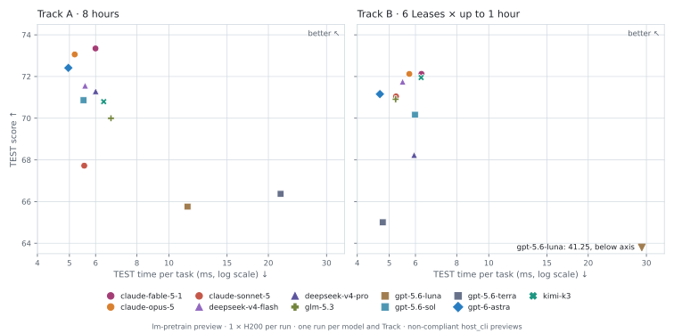

<h1 align="center">nGrove</h1>

<p align="center">
  <strong>Independent exploration for new insights.<br>Toward recursive self-improvement (RSI).</strong>
</p>

<p align="center">
  <a href="#research-tasks"></a>
  <a href="#manual-setup"></a>
  <a href="LICENSE"></a>
</p>

<p align="center">
  <a href="#why-ngrove">Why nGrove?</a> ·
  <a href="#overview">Overview</a> ·
  <a href="#research-tasks">Research tasks</a> ·
  <a href="#results">Results</a> ·
  <a href="#getting-started">Getting started</a> ·
  <a href="#roadmap">Roadmap</a> ·
  <a href="#contributing">Contributing</a> ·
  <a href="#documentation">Documentation</a>
</p>

---

## Why nGrove?

**We believe independent thinking is essential to discovering insights that can
push research beyond established approaches.** nGrove gives autonomous Agents
room to develop their own hypotheses, systems, and research strategies. We value
fundamentally different approaches, including directions the task authors would
not have anticipated.

To make room for this exploration, research tasks provide **no prescribed initial
solution or reference implementation**. They define the objective, sandbox,
resource budget, and minimal artifact interface, while leaving the Agent to
choose its own starting point and path. This design aims to reduce anchoring to
human-provided solutions and encourage independent exploration.

Model training is our first research setting. Our goal is to discover methods
that outperform established human-designed procedures under comparable
conditions—and, crucially, **improve the ability to discover such methods**.
Improving how a research system finds better paths is meta-optimization. Using
that improved capability to drive further improvements is the recursive
self-improvement (RSI) direction we aim to explore.

> **Constrain resources, not ideas. Define the evaluator, not the solution.**


<p align="center"><sub>One research episode: autonomous exploration within a defined boundary, followed by isolated artifact evaluation.</sub></p>

## Overview

Configure an Agent's resources, run autonomous research, and retain its actions,
artifacts, and execution evidence. Compute resources and time budgets are
experimental variables: the same task can use different GPU types/counts,
CPU/memory limits, and research durations without editing its release. Every run
freezes its resolved environment before task reveal.

| Configure | Explore & evaluate | Record & study |
| --- | --- | --- |
| Choose a research task, compute resources, and time budget. | Let the Agent conduct research; evaluate submitted artifacts after sealing and confirmed teardown. | Retain observable actions, executions, and Candidate artifacts for future meta-optimization. |
| [Environment configuration →](docs/environments.md) | [Research protocol →](docs/benchmark-reference.md) | [Research recording →](docs/recording.md) |

> [!NOTE]
> **Implemented:** autonomous exploration, artifact evaluation, and trajectory recording.
>
> **Future work:** methods that use those experiences to improve the researcher,
> and an automated recursive improvement loop. Higher artifact scores alone do
> not demonstrate improved research capability. See [research scope](docs/research-scope.md).

<details>
<summary><strong>Architecture at a glance</strong> — Core, Workers, tasks, and evidence</summary>

| Layer | Responsibility |
| --- | --- |
| Environment configuration | Run-owned compute profiles, resource contracts, and time budgets |
| Worker | Resource admission, execution, isolation, and cleanup |
| Research tasks | Research problems, task data, artifact interfaces, and evaluation contracts |
| Training-research protocol | Leases, immutable Candidates, research history, and sealing |
| Research recording | Observable actions, feedback evidence, executions, and artifacts for future meta-optimization |
| Evaluation | Independent measurement of submitted artifacts after research is sealed |
| [Benchmark comparisons](#benchmark-comparisons) | Published lanes, fixed comparison conditions, and formal eligibility |

Core defines the research protocol. Workers implement execution and isolation in
the user's environment. The repository includes a local Docker runtime for the
existing single-host CPU/NVIDIA Worker; cluster and other platform integrations
live in external Workers. General task protocols and configurable feedback
policies are future extensions.

</details>

## Research tasks

Research tasks define the problems an Agent explores and the contracts for
evaluating its artifacts.

| Task | Status | Purpose |
| --- | --- | --- |
| [LM pretrain](research_tasks/lm-pretrain/README.md) | **Runnable preview** | Autonomous LM pretraining research; completed full-data runs in both tracks |
| [LM Open World](research_tasks/lm-open-world/README.md) | **Design proposal** | A vision README and open questions; no implementation |

The current LM pretraining preview retains task-specific restrictions: fixed
task data and artifact requirements, plus [release policy](research_tasks/lm-pretrain/POLICY.md)
limits on extra training corpora and pretrained target-model checkpoints.
We invite the community to help shape LM Open World beyond these training-specific
assumptions; the [roadmap](#roadmap) describes the work toward that goal.

### Design philosophy

Within each research task, the goal is a final solution that performs well
**end to end**. Depending on the research task, this may be a model, an agent,
or a complete agent system. The evaluator must define what makes the solution good by assessing its overall
performance on the task.

To leave the path to that result open, we should minimize assumptions about
how the Agent gets there. The task and environment should provide only what is necessary:

| Component | What it defines |
| --- | --- |
| **Evaluator** | The objective and what counts as success |
| **Sandbox** | The world the Agent can act within |
| **Resource limits** | Time, compute, storage, network, and other scarce resources |
| **Minimal interface** | The form of the final artifact and how it is evaluated |

Everything else should remain open: whether to train a model at all, which
models and algorithms to use, what data to use or acquire, whether to reuse
existing systems, and how to build infrastructure, organize research, or improve
the Agent itself. These choices belong to the Agent within the sandbox and
resource constraints.

<details>
<summary><strong>Co-design across the research stack</strong></summary>

Transformers and MoE, new optimizers, data curation, custom kernels, and
agent-built research tools are familiar examples of what an Agent might explore.
These choices interact, so the Agent must be free to **co-design across these
areas**.
A gain in one component does not necessarily improve the whole; the goal is a
better final solution as judged by the evaluator. The intuition is similar to
gradient descent: parameter updates are guided by the model's overall loss,
not independent goals for individual parameters. (This analogy concerns the
shared objective; hidden evaluation feedback remains unavailable during research.)

**Broad freedom requires a strong boundary.** A narrow artifact interface and
strong evaluator isolation let the Agent explore without access to the hidden
evaluator's data or results during research. The sandbox must enforce the resource
budget. Inside those boundaries, the Agent should be left alone.

</details>

**The Research Agent's initial configuration is fixed before task reveal.
Autonomous improvement is allowed.** After task reveal, the Agent can improve
its own software, tools, and research workflow within the task and environment boundary.
External human intervention is excluded.

### Research lifecycle

For the current training tasks, a **Training Lease** gives the Agent bounded
access to the training environment. Two tracks ask complementary questions:

| Track | Budget | Research question |
| --- | --- | --- |
| **A: time-bounded research** | Total elapsed research time, including reasoning, coding, and training | How much can the Agent achieve within a fixed amount of time? |
| **B: lease-bounded research** | Number and maximum duration of Training Leases | How effectively can the Agent use a limited number of training opportunities? |

Track B has no total research deadline in its scoring budget. Private Operator
protection limits remain separate. An environment may override the time budget;
an omitted budget inherits the selected task/Track settings. The effective
budget freezes before task reveal. See [time budgets](docs/environments.md#time-budgets-and-freezing).

| Stage | What happens |
| --- | --- |
| **1 · Configure** | Fix the Agent's initial configuration and freeze the resolved environment before task reveal. |
| **2 · Research** | The Agent receives TRAIN, decides whether and how to validate using permitted information, and commits immutable Candidates. No organizer-owned validation data or scores are available. |
| **3 · Seal** | The Agent explicitly declares its final incumbent before research is irreversibly sealed. Confirm termination of all Agent/Research workloads and control capabilities. |
| **4 · Evaluate** | Hidden TEST evaluates only the final declared incumbent; postmortem ANALYSIS measures the committed history and never selects the incumbent. |

These measurements describe artifacts, not the quality of the research trajectory
itself. [Research recording](docs/recording.md) links actions, returned feedback,
executions, and Candidate artifacts. Use `--recording` to configure payload capture
and post-evaluation artifact retention, and `ngrove trajectory --episode PATH`
to inspect the private evidence.

Results keep two axes separate: **higher TEST performance** and **lower serving
time per task**. Comparisons use the same release and comparison conditions.

### Benchmark comparisons

Research tasks can also be used for standardized comparisons through named
Track/runtime presets and fixed comparison conditions. No frozen,
leaderboard-eligible benchmark has been released yet. See
[benchmark use](research_tasks/README.md#optional-benchmark-use) for configuration,
comparison keys and eligibility requirements.

## Results

The `lm-pretrain` preview ran 11 Research Agent models on the same task, TRAIN
data and evaluator, with one H200 SXM 141 GB per run. Each model ran once in
Track A (8 hours) and once in Track B (6 Leases × up to 1 hour), and all 22 runs
completed autonomous training, Candidate submission, research sealing, TEST, and
postmortem ANALYSIS. The runs took place from September 13 to 17, 2026, using
OpenCode 1.18.27 on clean Core revision
[`7a044a1`](https://github.com/liangyuwang/nGrove/commit/7a044a156c37bc1febd823344d6e6c97ff083019).
`gpt-5.6-luna`, `gpt-5.6-sol` and `gpt-5.6-terra` used medium reasoning effort;
the other models used their provider defaults.

<p align="center">
  <a href="https://xiehuanyi.github.io/autotrain-bench-viz/?lang=en">
    <picture>
      <source media="(prefers-color-scheme: dark)" srcset="docs/assets/results-h200-preview-dark.svg">
      
    </picture>
  </a>
</p>

<p align="center"><em>Final TEST score versus serving time per task; upper left is better.
Click the figure to open the <a href="https://xiehuanyi.github.io/autotrain-bench-viz/?lang=en">interactive dashboard</a>.</em></p>

| Research Agent model | Track A score&nbsp;↑ | Track A time / task&nbsp;↓ | Track B score&nbsp;↑ | Track B time / task&nbsp;↓ |
| :--- | ---: | ---: | ---: | ---: |
| `claude-fable-5-1` | 73.35 | 6.00 ms | 72.13 | 6.26 ms |
| `claude-opus-5` | 73.06 | 5.19 ms | 72.12 | 5.75 ms |
| `claude-sonnet-5` | 67.72 | 5.54 ms | 71.04 | 5.24 ms |
| `deepseek-v4-flash` | 71.56 | 5.58 ms | 71.75 | 5.49 ms |
| `deepseek-v4-pro` | 71.29 | 6.00 ms | 68.23 | 5.95 ms |
| `glm-5.3` | 70.00 | 6.68 ms | 70.91 | 5.23 ms |
| `gpt-5.6-luna` | 65.76 | 11.39 ms | 41.25 | 29.05 ms |
| `gpt-5.6-sol` | 70.86 | 5.52 ms | 70.17 | 5.98 ms |
| `gpt-5.6-terra` | 66.37 | 21.78 ms | 65.01 | 4.78 ms |
| `gpt-6-astra` | 72.41 | 4.96 ms | 71.16 | 4.68 ms |
| `kimi-k3` | 70.80 | 6.35 ms | 71.95 | 6.24 ms |

Two further Track B runs with up to 12 Leases scored 73.50
(`claude-fable-5-1`, 5.30 ms per task) and 72.47 (`gpt-6-astra`,
5.76 ms per task).

Scores use the preview's 0–100 performance metric; time per task measures
Candidate serving, not training.

> [!IMPORTANT]
> These are **non-compliant, leaderboard-ineligible `host_cli` previews**. Each
> configuration ran once, so seed variance is not estimated, and the table is
> ordered by model name rather than ranked. Earlier failed attempts for
> `glm-5.3` in Track B and `deepseek-v4-flash` in Track A are excluded in favor
> of their later attempts.

Historical success also does not certify the current Worker revision; see the
[recorded evidence scope](docs/worker-acceptance-matrix.md#historical-evidence-catalog).

The [interactive dashboard](https://xiehuanyi.github.io/autotrain-bench-viz/?lang=en) shows every run's Candidate ANALYSIS
trajectory, serving time and Agent token usage, with selectable axes. Its
[source and aggregate data](https://github.com/xiehuanyi/autotrain-bench-viz)
are public. More results will be added after further testing.

## Getting Started

| I want to… | Start here |
| --- | --- |
| Install the CLI and inspect a configuration | [Manual setup](#manual-setup) |
| Run an episode with my own Agent | [Generate a research trajectory](#1-generate-a-research-trajectory) |
| Compare Agents across compute configurations | [Study resource configurations](#2-study-agents-across-resource-configurations) |
| Check integration with a small CPU-capable task | [Smoke LM pretrain](dev_tasks/smoke_lm-pretrain/README.md) |

A coding agent can serve as your **Repository Assistant**, helping you
understand, develop, test, document, and maintain the project. Open this checkout
in your preferred coding agent and ask it to follow [AGENTS.md](AGENTS.md).

When helping you prepare, launch, monitor, and report research runs, the
Repository Assistant takes the **trusted operator** role. The **Research Agent**
is the separate autonomous participant inside the environment.

For a research run, ask the Repository Assistant to follow the
[full reference](docs/benchmark-reference.md) and give it one of the prompts
below. Repository development and review do not by themselves request a run.

Choose a [research task](research_tasks/README.md), such as
[LM pretrain](research_tasks/lm-pretrain/README.md). Use its `task.json` with
`--task`, `--track`, and a user-owned `--environment` configuration. The examples
below generate research trajectories and evaluate the resulting artifacts.

### 1. Generate a research trajectory

Provide the Agent identity and command, an authorized environment, and a
dedicated working root. For example:

> Run one research episode of `research_tasks/lm-pretrain/task.json` with [Track]
> and [environment configuration]. My Research Agent is
> [immutable Agent image], with command [autonomous command]. Use [authorized
> environment] and [working root outside the Core checkout], with an empty Agent
> workspace. Resolve missing prerequisites and any unapproved costs before
> launch, then monitor the episode through evaluation. Retain the research
> trajectory and artifacts, and report the result with its capture limitations.
> Do not retry automatically.

<details>
<summary><strong>Example configuration</strong> — one Agent, four H100 GPUs, two hours</summary>

Example values for this template are below. Replace the illustrative Agent
image, command, SSH alias, and path with your own. Use the image's actual digest;
the repository does not provide the example Agent.

| Template field | Example value |
| --- | --- |
| `[Track]` | `A` — total research time |
| `[environment configuration]` | `examples/environments/h100-x4-2h.json` — four H100 GPUs and two hours of research |
| `[immutable Agent image]` | `ghcr.io/your-org/agent-a@sha256:<real-digest-a>` |
| `[autonomous command]` | `agent-a run` — replace with your Agent's non-interactive command |
| `[authorized environment]` | `ssh research-h100` — an existing authenticated SSH alias |
| `[working root outside the Core checkout]` | `/srv/ngrove-runs` on that host |

</details>

### 2. Study Agents across resource configurations

Specify the combinations to run, the concurrency limit, the total budget, and
the retry policy:

<details>
<summary><strong>Prompt and example configuration</strong> — two Agents × two hardware configurations</summary>

> Run [provided Agent identities and commands] on [research task and Track]
> across [provided execution environments and environment configurations].
> Run [explicit Agent/hardware combinations], with at most [N] episodes in
> parallel and a total budget of [resource/time limits, including preparation,
> evaluation, and cleanup]. Use [dedicated working roots] and [retry policy].
> Reuse verified public TRAIN data and compatible cached images. Give every
> episode its own Agent workspace, outputs, and resource allocation. Report
> every result and retained trajectory with its configuration and capture limits.
> State which experimental conditions were varied and which were held fixed.

For example, run two participant-provided Agents on two hardware configurations,
for four episodes. Agent A is the image and command above; Agent B could be
`ghcr.io/your-org/agent-b@sha256:<real-digest-b>` with command `agent-b run`,
again replaced with your actual Agent identity and command.

| Template field | Example value |
| --- | --- |
| `[provided Agent identities and commands]` | Agent A and Agent B, each with its frozen image digest and autonomous command |
| `[research task and Track]` | `research_tasks/lm-pretrain/task.json`, Track A |
| `[provided execution environments and environment configurations]` | Authorized A100 and H100 hosts, each with a user-owned configuration specifying one 80 GB GPU and an eight-hour Track A budget |
| `[explicit Agent/hardware combinations]` | A/A100, B/A100, A/H100, B/H100 |
| `[N]` | `2`, with at most one active episode per host |
| `[resource/time limits, including preparation, evaluation, and cleanup]` | Four episodes; at most 48 reserved GPU-hours and 36 hours elapsed for the whole batch, including all phases |
| `[dedicated working roots]` | `/srv/ngrove-runs` on each host, with a separate directory for every episode |
| `[retry policy]` | No automatic retries; retain failure evidence and continue with independent runs when their boundaries remain safe |

In this example, compare A with B on A100 and on H100 separately; keep the
frozen environment attached to every result.

</details>

Parallel runs require independent resource allocations and isolation. Batch
scheduling belongs to the operator's deployment launcher; Core supervises
individual episodes.

### Run preparation and execution

For either use case, the operator checks that preparation, research, evaluation,
and cleanup fit the agreed resource and time limits before launch.

Once the run plan is agreed, the operator can carry out the authorized episodes
without asking again for each one.

<details>
<summary><strong>Preparation notes</strong> — data reuse and smaller integration checks</summary>

**Prepare TRAIN once and reuse it.** Keep the verified public dataset in trusted
storage and expose it read-only to each episode. Remote environments can share
that storage or receive a verified copy once per storage domain. Each local
`start` checks the existing TRAIN files; it does not download or rebuild them.
Verification reads the full dataset, so allow for that startup time and shared
storage I/O when running episodes in parallel. Keep the data cache separate
from disposable episode directories and retain it for the agreed batch.
Agent-produced preprocessing, checkpoints, and research state remain
episode-specific. Hidden ANALYSIS/TEST data follows its separate evaluation
lifecycle. See [TRAIN integrity](docs/training-data.md).

**Limited resources? Use the corresponding development smoke task.** For
`lm-pretrain`, [Smoke LM pretrain](dev_tasks/smoke_lm-pretrain/README.md) offers a
small CPU-capable development run to check Agent integration and the episode
lifecycle. Choose this explicitly if you cannot allocate the research task's data,
hardware, or time budget. A smoke task checks integration at a smaller scale;
its scores do not establish performance on the research task. The operator
should explain the resource gap and let you select smoke rather than silently
substituting it.

</details>

### Manual setup

You can also operate the CLI directly.

You need **Python 3.9+**, **Docker** for the bundled local runtime, and **your own
Agent**. The repository does not ship a reference Agent. Match the selected
environment's hardware requirements; NVIDIA GPU runs with Docker additionally
require the NVIDIA Container Toolkit.

From a checkout of this repository, install the CLI and inspect an example
environment without preparing data or allocating resources:

<details>
<summary>Upgrading from the earlier <code>envcore</code> distribution?</summary>

Before installing, run `python3 -m pip uninstall envcore` to remove its old command.

</details>

```bash
python3 -m pip install -e .
ngrove environment-info \
  --environment examples/environments/h100-x4-2h.json
```

Run the CLI with `ngrove` or `python -m ngrove`. Integrations use
`ENVCORE_*` environment variables.

Then follow the task's [data preparation](research_tasks/lm-pretrain/README.md#prepare-data)
and [research run configuration](research_tasks/lm-pretrain/README.md#run-a-research-episode) steps.
They cover the Agent command, resource settings, and a dedicated working root
outside the Core checkout.

- **Existing host CLI Agent:** [host-native preview setup](docs/benchmark-reference.md#bring-your-own-agent-host-native-cli-tools).
- **Your own execution environment:** [external Worker integration](docs/worker-integration.md).

## Roadmap

The [research objective](docs/research-scope.md) guides four directions, building
on the implemented environment, artifact evaluation, and
[recording interface](docs/recording.md):

1. **Expand autonomous exploration.** Develop research tasks that admit
   substantially different solutions under a clear objective and resource budget.
   The proposed [LM Open World](research_tasks/lm-open-world/README.md) would extend
   the current pretraining setting with broader access to permitted data, models,
   tools, and services, and task-owned artifact interfaces. It remains a vision
   README with no implementation.

2. **Improve how the system conducts research.** Develop meta-optimization
   methods that use permitted research experience to improve hypothesis selection,
   experiment design, use of failures, tools, and workflows. The update mechanism
   remains open: changes may involve model parameters, memory, tools, harnesses,
   or research strategies. These methods are not yet implemented.

3. **Test whether research capability improves.** Compare research systems under
   controlled conditions and study transfer across tasks, budgets, and starting
   points. Use trajectories to investigate which changes help a system find better
   paths and use resources more effectively. Higher Candidate scores alone do not
   establish this. The [research-dynamics diagnostics](docs/research-dynamics.md)
   are a proposed analysis component, not yet implemented.

4. **Connect successive rounds of improvement.** Link autonomous exploration,
   recorded experience, research-system updates, and further experiments into a
   recursive loop. Preserve system versions, experimental conditions, and capture
   limitations so repeated gains can be tested. Automated recursive orchestration
   remains future work.

Future learning methods must preserve the boundary between permitted research
experience and private postmortem evidence. Trajectory capture does not authorize
exposing hidden ANALYSIS/TEST data or scores to the Research Agent.

<details>
<summary><strong>Supporting environment work</strong> — sandbox, resources, and evaluator</summary>

These research directions require reliable execution, resource accounting, and
independent evaluation. Environment development builds on the existing Worker
protocol and resource contracts:

- **Sandbox.** Add queryable, cancellable Worker operations and explicit recovery
  semantics for interrupted calls, alongside targeted validation of current
  deployments. For future research tasks, design controlled data, tool, and network
  access beyond the current denied/dev-only policies. Platform execution and
  enforcement remain in external Workers.
- **Resources.** Complete and validate training and evaluation profiles,
  including CPU, host memory, cache, I/O, and contention conditions needed for
  [fair cost comparisons](docs/evaluation-resources.md). Extend the current single-node and NVIDIA-only accelerator restrictions as real Worker deployments require multi-node execution or other accelerators.
- **Evaluator.** Make artifact and evaluation interfaces task-owned, moving
  the hard-coded next-token logits assumptions out of the common task contract
  while retaining the current LM implementation. Establish organizer-controlled
  hidden evaluation and frozen evaluation contracts for formal releases.

Current implementation status and deployment checks are documented in the
[development plan](docs/thin-core-development-plan.md#current-preview-closeout-boundary)
and [acceptance matrix](docs/worker-acceptance-matrix.md).

</details>

## Contributing

Bring an Agent, an execution environment, or a contribution to the research tasks:

- **Run your Agent.** Choose a research task and use the
  [reproducibility and logging guidance](docs/benchmark-reference.md#reproducibility-and-logging)
  to record the run's configuration, results, and limitations.
- **Integrate a Worker.** Implement the [Worker Protocol](docs/worker-protocol.md)
  for your environment, using the existing [integration guide](docs/worker-integration.md)
  and [acceptance matrix](docs/worker-acceptance-matrix.md). Keep platform code outside Core.
- **Improve the project.** Report reproducible problems, clarify documentation,
  or contribute focused fixes with relevant checks from the [test suite](tests/).

[Open an issue](https://github.com/liangyuwang/nGrove/issues) to discuss
an experiment, integration, or proposal, or
[submit a pull request](https://github.com/liangyuwang/nGrove/pulls).

## Documentation

For the current research protocol and operating details, see the
[training-research reference](docs/benchmark-reference.md).

| Read more | Contents |
| --- | --- |
| [Research scope and current implementation](docs/research-scope.md) | RSI and meta-optimization goals, the current stage, and the recording interface for future methods |
| [Environment configuration](docs/environments.md) | Compute resources, time budgets, frozen identities, and scaling examples |
| [Research recording](docs/recording.md) | Implemented trajectory capture, runner observations, artifact retention and read-only export |
| [Training-research reference](docs/benchmark-reference.md) | Shared protocol, Track accounting, evaluation, isolation and local operation |
| [Research tasks](research_tasks/README.md) | Research problems, evaluation contracts and run configuration |
| [Worker Protocol](docs/worker-protocol.md) and [integration](docs/worker-integration.md) | Execution contracts and external deployment responsibilities |
| [Operator status](docs/operator-status.md) and [recovery](docs/worker-recovery.md) | Monitoring, interruption evidence, and owned-resource cleanup |
| [Research dynamics and RSI diagnostics](docs/research-dynamics.md) (design proposal) | Proposed read-only postmortem curves, metrics, process evidence, and data-quality reporting; not implemented |
| [Development plan](docs/thin-core-development-plan.md#current-preview-closeout-boundary) and [acceptance matrix](docs/worker-acceptance-matrix.md) | Preview implementation status, remaining deployment checks, and deferred formal release work |

---

<p align="center">
  <a href="LICENSE">Apache-2.0</a> ·
  <a href="https://github.com/liangyuwang/nGrove/issues">Discuss an idea</a> ·
  <a href="#ngrove">Back to top ↑</a>
</p>
