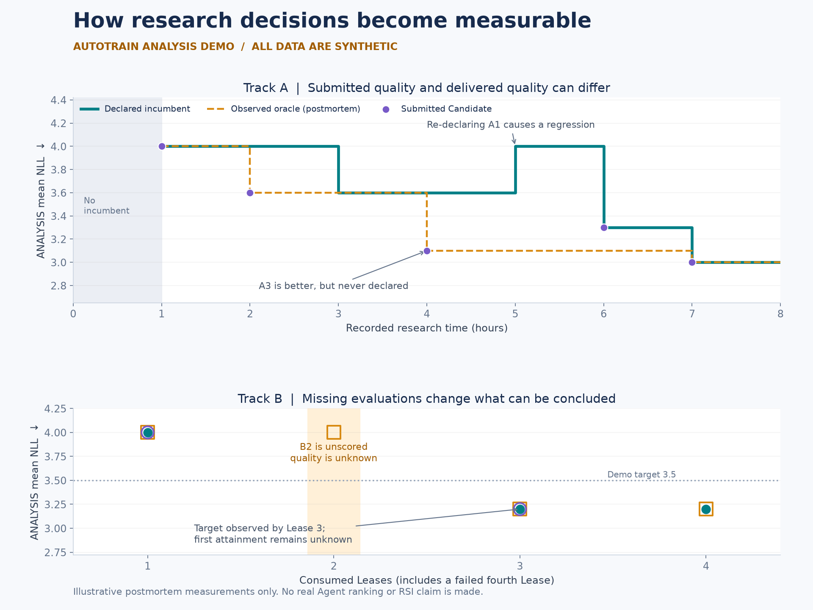

# Research analysis worked example

Read the [English report](report/report.md), [metrics](report/analysis.json),
and [evidence annotations](report/evidence.jsonl). Every measurement and process
note is invented. The example demonstrates the
[analysis skill](../../skills/autotrain-analysis/SKILL.md), not actual RSI behavior.



The report distinguishes submitted quality, declared-incumbent quality, and the
observed oracle. It includes a better undeclared Candidate, a regression,
repeated declarations, an unscored incumbent, and a failed consumed Lease.
Missing quality makes the full-domain mean unavailable; an observed success
after a gap supplies an attainment upper bound rather than an exact first time.

To regenerate the optional static figures and report, use Python 3.12+ with
Matplotlib. From the repository root:

```sh
python3 -m venv /path/to/demo-venv
/path/to/demo-venv/bin/python -m pip install -r examples/research-dynamics/requirements.txt
/path/to/demo-venv/bin/python examples/research-dynamics/build_demo.py
```

On Windows, use the virtual environment's `Scripts/python.exe`. The script
reads only the demo fixture/configuration and writes `report/`. The metric
checks run during generation. It does not accept official result schemas or
implement the proposed production `bench_analysis` pipeline.

The separate [interactive visualization](../../tools/visualization/README.md)
can render the same synthetic input with `--demo`, without Matplotlib.
